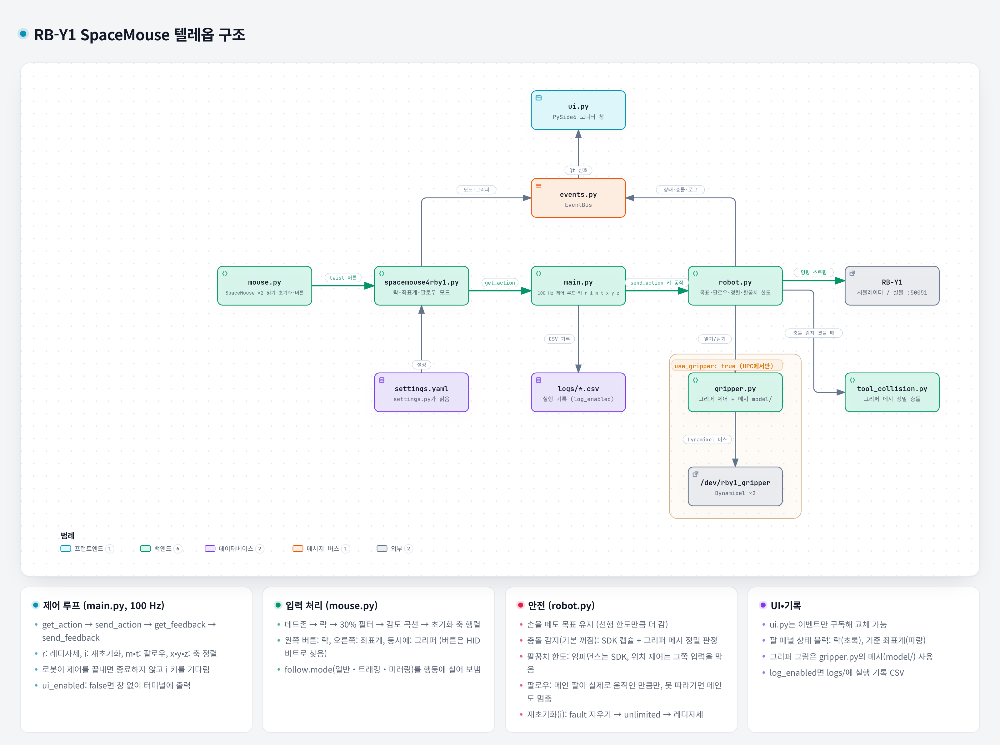

# RB-Y1 SpaceMouse Teleop

두 대의 3Dconnexion SpaceMouse로 Rainbow Robotics RB-Y1의
양팔을 조작하기 위한 LeRobot teleoperator 플러그인입니다.

## 주요 기능

- 레디자세로 이동한 뒤 양팔을 마우스로 Cartesian 제어 (위치 제어 / 임피던스 제어)
- 팔마다 락(포지션락/회전락), 기준 좌표계(베이스/그리퍼), 그리퍼 열기·닫기
- 트래킹·미러링 (메인 팔을 따르는 팔이 같이 움직임)
- 축 정렬 (따르는 팔의 앞뒤·좌우·높이를 메인 팔에 맞춤)
- 레디자세 복귀, 로봇이 멈춘 뒤 재초기화
- 모니터 창: 상태, 조작 버튼, 그리퍼 그림, 실행 로그

## 사용한 3D 마우스

[3Dconnexion SpaceMouse Wireless (Bluetooth Edition)](https://3dconnexion.com/us/product/spacemouse-wireless/) 두 대를 사용했습니다.
USB 케이블, 블루투스, 3Dconnexion Universal Receiver(동글) 세 가지로 연결할 수 있습니다.
([사용 설명서](https://3dconnexion.com/manuals/spacemouse-wireless/en/Manual_3Dconnexion-SpaceMouse-Wireless_BT_EN.pdf))

> [!CAUTION]
> 동글(Universal Receiver)로 쓰려면 먼저 Windows나 macOS에서 [3DxWare 드라이버](https://3dconnexion.com/drivers/)를 설치하고,
> 마우스를 동글에 등록(페어링)해야 합니다. 리눅스에서는 등록할 수 없습니다.
> 등록하지 않은 동글은 인식은 되지만 마우스 입력이 들어오지 않습니다.

## 요구사항

- Linux (Ubuntu)
- Python 3.12
- LeRobot, RB-Y1 Python SDK (아래 `pip install`에서 함께 설치됩니다)
- SpaceMouse 두 대
- HIDAPI
- 그래픽 화면 (모니터 창을 쓸 때)

## 설치

HIDAPI를 설치합니다.

```bash
sudo apt update
sudo apt install libhidapi-dev
```

저장소를 받습니다.

```bash
git clone https://github.com/JeonSangMin-sw2/rby1_3d_mouse_teleop.git
cd rby1_3d_mouse_teleop
```

이미 쓰고 있는 Python 환경(예: LeRobot 콘다 환경)을 활성화한 상태에서 패키지를 설치합니다.

```bash
pip install -e ".[ui]"
```

- `[ui]`는 모니터 창에 쓰는 `PySide6`를 함께 설치합니다.
- 설치하면 `rby1-spacemouse-teleop` 명령이 생깁니다.

### Jetson 등 aarch64 PC에서 PySide6 설치

PyPI의 `PySide6`는 aarch64용으로 glibc 2.39 이상(Ubuntu 24.04 이상)만 있어서, Ubuntu 22.04 기반 Jetson에서는
`pip install`이 소스 빌드로 넘어가 실패합니다. 이때는 **콘다 환경을 활성화한 상태에서** conda-forge로 먼저 설치한 뒤
위 `pip install`을 실행합니다. `conda install`은 지금 활성화된 콘다 환경에 설치됩니다.

```bash
conda activate lerobot
```

```bash
conda install -c conda-forge pyside6
```

### (선택) 별도 가상환경 만들기

LeRobot 환경 없이 따로 쓰려면 Python 가상환경을 만들고 활성화한 뒤 위 `pip install`을 실행합니다.
LeRobot 환경에 넣어 쓸 때는 필요 없습니다.

```bash
sudo apt install python3.12-venv
python3.12 -m venv .venv
source .venv/bin/activate
```

## SpaceMouse 연결 설정

기본 설정에서는 `/dev/hidraw*` 장치를 root만 열 수 있어서, SpaceMouse가 감지되어도
`Failed to open device` 오류가 나고 입력을 읽을 수 없습니다.
3Dconnexion 장치(vendor ID `256f`)에 접근 권한을 주는 udev 규칙을 추가합니다.

```bash
echo 'KERNEL=="hidraw*", KERNELS=="*:256F:*", MODE="0660", GROUP="plugdev", TAG+="uaccess"' \
  | sudo tee /etc/udev/rules.d/99-spacemouse.rules
```

```bash
sudo udevadm control --reload-rules && sudo udevadm trigger
```

사용자가 `plugdev` 그룹에 있어야 합니다. `groups` 출력에 `plugdev`가 없으면 추가하고
**로그아웃 후 다시 로그인**(또는 재부팅)합니다.

```bash
sudo usermod -aG plugdev $USER
```

마우스를 다시 꽂은 뒤 SpaceMouse 경로가 `root plugdev`, `crw-rw----`로 보이면 적용된 것입니다.

```bash
ls -l /dev/hidraw*
```

> [!CAUTION]
> - `sudo chmod`로 직접 바꾼 권한은 마우스를 뺐다 꽂으면 사라집니다. 권한은 위 udev 규칙으로만 주세요.
> - SSH나 원격 접속으로 실행하면 `plugdev` 그룹이 꼭 필요합니다. 규칙의 `uaccess`는 화면에 직접 로그인한 사용자에게만 권한을 줍니다.
> - `/dev/hidraw*` 번호는 다시 꽂거나 재부팅하면 바뀔 수 있습니다. 마우스와 팔의 연결은 실행할 때마다 다시 정합니다.
> - 무선 마우스의 연결이 끊겨도 `/dev/hidraw*` 경로는 남아 있을 수 있습니다. 경로가 보인다고 연결된 것은 아닙니다.
> - 마우스가 다른 PC에 블루투스로 연결되어 있으면 그쪽으로만 입력이 갑니다. 다른 PC의 블루투스 연결을 끊고 쓰세요.

## SpaceMouse 인식 확인

두 SpaceMouse를 연결하고 실행합니다.

```bash
python check_mouse.py
```

감지된 마우스와 열기 결과를 보여 준 뒤, 6축 값과 버튼을 0.1초마다 출력합니다.
마우스를 움직였을 때 값이 바뀌면 됩니다. 값이 계속 0이면 전원과 연결 상태를 확인하세요. `Ctrl+C`로 끝냅니다.

## 마우스 초기화

텔레옵을 시작하면 먼저 터미널에서 마우스 초기화를 합니다.
마우스를 어느 방향으로 밀면 로봇 팔이 앞으로 가게 할지를 정하는 단계입니다.

1. `[오른팔]` 안내가 나오면, 오른팔에 쓸 마우스를 **로봇이 앞으로 가길 원하는 방향**으로 밀고 0.5초 유지합니다.
   움직인 마우스가 오른팔 마우스가 됩니다.
2. `마우스에서 손을 떼주세요`가 나오면 손을 뗍니다.
3. `[왼팔]`도 남은 마우스로 같은 방법으로 합니다.

- 위로 들어올리면 위, 누르면 아래입니다. 좌우는 앞 방향에 맞춰 자동으로 정해집니다.
- 대각선으로 밀면 다시 밀라고 안내합니다. 두 마우스를 동시에 움직이면 인식하지 않습니다.

## 텔레옵 실행

> [!WARNING]
> 로봇이 움직입니다. 주변을 비우고 비상정지 스위치 위치를 확인하세요.

### 설정

설정은 [`src/lerobot_teleoperator_spacemouse4rby1/settings.yaml`](src/lerobot_teleoperator_spacemouse4rby1/settings.yaml)에서
바꿉니다. 키마다 설명이 달려 있습니다. 키를 빠뜨리거나 모르는 키가 있으면 시작할 때 알려 주고 멈춥니다.

| 키 | 설명 |
|---|---|
| `robot_address` | 로봇 주소. `127.0.0.1:50051`은 시뮬레이터, `192.168.30.1:50051`은 실물 |
| `impedance_enabled` | `true`면 Cartesian 임피던스 제어, `false`면 Cartesian 위치 제어 |
| `unlimited_mode` | control manager를 unlimited mode로 켬 (켤 때 관절 범위를 검사하지 않음) |
| `log_enabled` | 실행 기록(CSV)을 프로젝트의 `logs/`에 남길지 |
| `ui_enabled` | 모니터 창을 띄울지. `false`면 창 없이 상태를 터미널에 출력 |
| `use_gripper` | 그리퍼를 쓸지. 로봇의 UPC에서 실행할 때만 `true`. 시작할 때 툴 플랜지를 12V로 맞추고 그리퍼 homing |
| `max_gripper_open` | 그리퍼를 열었을 때 벌어지는 정도 0~1000 (1000 = 끝까지) |
| `tcp_offset_m` | 마우스 이동·회전의 기준점. 그리퍼 몸통 좌표계 [m]. `[0, 0, -0.133]`이면 두 손가락 끝 사이 |
| `ready_pose_deg`, `ready_minimum_time_s` | 레디자세 [deg]와 레디자세로 가는 시간 [s] |
| `linear_velocity`, `angular_velocity` | 마우스를 끝까지 밀었을 때의 속도 [m/s], [rad/s] |
| `linear_acceleration`, `angular_acceleration` | 가속도 한도 (임피던스 제어) |
| `acceleration_limit_scaling` | 가속도 한도 비율 0~1 (위치 제어) |
| `command_minimum_time_s` | 명령 하나가 목표까지 가는 최소 시간 [s]. 움직임이 끊기면 늘리고, 반응이 늦으면 줄임 |
| `align_velocity` | 축 정렬(`x`, `y`, `z` 키) 속도 [m/s] |
| `arm_stiffness`, `arm_torque_limit`, `arm_damping_ratio` | 임피던스 제어 관절 게인 |
| `elbow_limit_rad` | 팔꿈치가 다 펴져 특이점에 걸리지 않게 막는 범위 [rad]. 범위 끝에 닿으면 그 방향으로 더 가지 않음 |
| `max_target_lead_m`, `max_target_lead_rad` | 목표가 실제 자세보다 앞설 수 있는 최대 거리·각도 (위치 제어) |
| `impedance_max_target_lead_m`, `impedance_max_target_lead_rad` | 같은 한도 (임피던스 제어). 실물에서 덜 움직이면 늘림 |
| `stall_progress_ratio` | 막힌 방향으로 계속 밀 때 팔이 흔들리지 않게 그 방향 입력을 멈추는 기준 (위치 제어). 크면 일찍 멈춰 덜 흔들리고, 작으면 더 감. 0이면 끔 |
| `collision_check_enabled` | 팔끼리·몸통과 가까워지면 경고하고 막을지. **기본 `false`(꺼짐)** |
| `collision_distance_m`, `collision_release_margin_m` | 충돌 경고 거리와, 경고가 풀리는 데 필요한 추가 거리 [m] |
| `main_arm` | 메인 팔 (`right` / `left`). 트래킹·미러링과 축 정렬의 기준 |
| `deadzone` | 이보다 작은 마우스 입력은 무시 |
| `axis_filter_ratio` | 가장 크게 민 축의 이 비율 이하인 축은 무시 (0이면 끔) |
| `translation_curve_temperature`, `rotation_curve_temperature` | 감도 곡선 (이동 / 회전). 클수록 조금 밀었을 때 더 천천히 움직임. 0이면 민 만큼 비례 |

### 실행

```bash
rby1-spacemouse-teleop
```

1. 터미널 안내에 따라 [마우스 초기화](#마우스-초기화)를 합니다.
2. 로봇이 연결되고 레디자세로 이동합니다. (약 5초)
3. 마우스대로 각 팔이 움직입니다.
4. 창을 닫거나 터미널에서 `Ctrl+C`를 누르면 끝납니다. 로봇 전원과 서보는 끄지 않습니다.

로봇이 특이점이나 관절 한도로 스스로 멈추면 원인을 보여 주고 기다립니다.
이때 키보드 `i`를 누르면 다시 레디자세로 돌아가 이어서 조작할 수 있습니다.

> [!NOTE]
> 재초기화(`i`)한 뒤에는 프로그램을 끝낼 때까지 unlimited mode(관절 범위 검사 안 함)로 제어합니다.

### 버튼과 키보드

| 입력 | 동작 |
|---|---|
| 마우스 왼쪽 버튼 | 그 팔의 락 변경: 락 없음 → 포지션락 → 회전락 |
| 마우스 오른쪽 버튼 | 그 팔의 기준 좌표계 변경: 베이스 ↔ 그리퍼 |
| 마우스 두 버튼 동시에 | 그 팔 그리퍼 열기 / 닫기 |
| 키보드 `r` | 양팔 레디자세로 돌아가기 |
| 키보드 `i` | 재초기화 (로봇이 멈췄을 때만) |
| 키보드 `m` | 미러링 켜기 / 끄기 |
| 키보드 `t` | 트래킹 켜기 / 끄기 |
| 키보드 `x`, `z` | 따르는 팔의 앞뒤(x) / 높이(z)를 메인 팔에 맞춤 |
| 키보드 `y` | 따르는 팔의 좌우(y)를 메인 팔과 대칭으로 맞춤 |

키보드는 모니터 창에서 바로 누르거나(창의 버튼을 눌러도 됨), 터미널에 입력하고 Enter를 누릅니다.

## 구조



## 참고 프로젝트

- [LeRobot](https://github.com/huggingface/lerobot)
- [rby1-lerobot](https://github.com/RainbowRobotics/rby1-lerobot)
- [rby1-sdk](https://github.com/RainbowRobotics/rby1-sdk)
- [PySpaceMouse](https://spacemouse.kubaandrysek.cz/)
