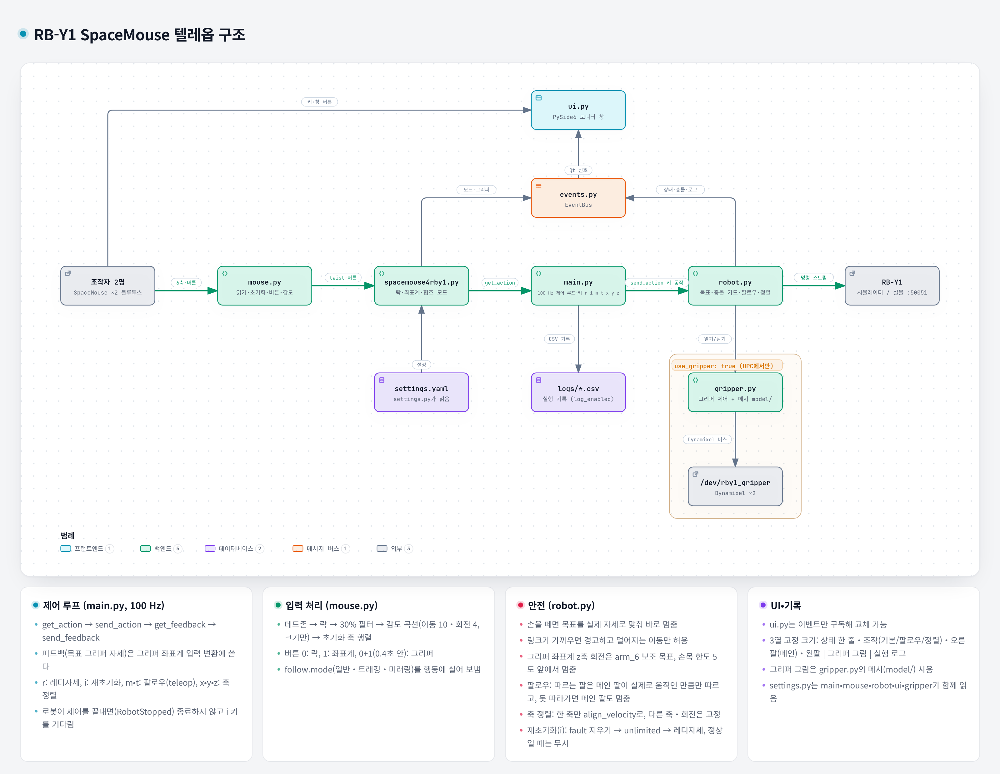

# RB-Y1 SpaceMouse Teleop

두 대의 3Dconnexion SpaceMouse로 Rainbow Robotics RB-Y1의
양팔을 조작하기 위한 LeRobot teleoperator 플러그인입니다.

## 주요 기능

- 연결된 SpaceMouse 감지와 입력 값 확인 (USB 수신기, 블루투스)
- 마우스 초기화: 왼팔/오른팔 마우스 매핑과 로봇 기준 축 설정
- 3D 공간의 구로 SpaceMouse 입력 방향 확인
- 텔레옵: 레디자세 이동 후 양팔을 마우스로 Cartesian 제어
  - 팔마다 락(포지션락/회전락), 기준 좌표계(베이스/그리퍼), 그리퍼 토글
  - 트래킹·미러링(메인 팔 주도, 메인 팔이 실제로 움직인 만큼만 따름), 레디자세 복귀, 축 정렬(x, y 대칭, z), 정지 후 재초기화
  - 그리퍼 좌표계 z축 회전은 손목 위주로, 손목 한도에서 멈춤
  - 링크 충돌 경고, 비선형 감도, 실행 기록(CSV)
  - 모니터 창: 상태, 조작 버튼, 그리퍼 모델 그림, 실행 로그

구조는 아래 [구조](#구조)의 그림에서 볼 수 있습니다.

## 요구사항

- Linux (Ubuntu)
- Python 3.12 가상환경
- LeRobot
- RB-Y1 Python SDK
- SpaceMouse 두 대
- HIDAPI
- 그래픽 화면 (모니터 창, 3D 뷰어용)

LeRobot, RB-Y1 Python SDK와 Python 패키지는 아래 `pip install`에서
함께 설치됩니다.

## 설치

HIDAPI와 Python 가상환경 도구를 설치합니다.

```bash
# Ubuntu / Debian
sudo apt update
sudo apt install libhidapi-dev python3.12-venv
```

저장소를 clone하고 가상환경을 만듭니다.

```bash
git clone https://github.com/JeonSangMin-sw2/rby1_3d_mouse_teleop.git

cd rby1_3d_mouse_teleop

python3.12 -m venv .venv
source .venv/bin/activate
```

패키지를 설치합니다.

```bash
pip install -e ".[viz,ui]"
```

- `[viz]`: 3D 뷰어에 쓰는 `matplotlib`, `PySide6`를 함께 설치합니다.
  matplotlib가 `PySide6`로 창을 띄우므로 시스템 Python에 `tkinter`가 없어도 됩니다.
- `[ui]`: 텔레옵 모니터 창에 쓰는 `PySide6`를 설치합니다.
- Jetson 같은 aarch64 PC에서는 PyPI의 `PySide6` 휠이 glibc 2.39 이상용뿐이라
  (Ubuntu 22.04는 2.35) pip 설치가 소스 빌드로 넘어가 실패합니다.
  이때는 conda-forge에서 먼저 설치한 뒤 위 명령을 실행합니다.

  ```bash
  conda install -c conda-forge pyside6
  ```
- 설치하면 가상환경에 `rby1-spacemouse-teleop` 명령이 생깁니다.

설치 확인:

```bash
pip show lerobot_teleoperator_spacemouse4rby1
```

## SpaceMouse 권한 설정

기본 설정에서는 `/dev/hidraw*` 장치를 root만 열 수 있습니다.
이 상태에서는 SpaceMouse가 감지되어도 `Failed to open device`
오류가 나고 입력을 읽을 수 없습니다.

```bash
ls -l /dev/hidraw*
# crw------- 1 root root ... /dev/hidraw5   ← root만 접근 가능
```

3Dconnexion 장치(vendor ID `256f`)에 접근 권한을 주는
udev 규칙을 추가합니다. USB 수신기와 블루투스 연결을 모두 잡도록
장치 경로(`0003:256F:...` USB, `0005:256F:...` 블루투스)로 고릅니다.
블루투스 장치에는 `idVendor` 속성이 없어서 `ATTRS{idVendor}`로는
잡히지 않습니다.

```bash
echo 'KERNEL=="hidraw*", KERNELS=="*:256F:*", MODE="0660", GROUP="plugdev", TAG+="uaccess"' \
  | sudo tee /etc/udev/rules.d/99-spacemouse.rules

sudo udevadm control --reload-rules
sudo udevadm trigger
```

적용되었는지 확인합니다.

```bash
ls -l /dev/hidraw*
```

SpaceMouse 경로의 그룹이 `plugdev`로, 권한이 `crw-rw----`로
바뀌었으면 적용된 것입니다.

- 사용자가 `plugdev` 그룹에 있어야 합니다. `groups` 명령으로
  확인하세요.
- 적용되지 않으면 수신기를 다시 꽂아보세요.
- 장치 경로는 `udevadm info -a -n /dev/hidraw5 | grep KERNELS`로
  확인할 수 있습니다.

## SpaceMouse 인식 확인

두 SpaceMouse를 연결하고 다음 명령을 실행합니다.

```bash
python check_mouse.py
```

- 감지된 SpaceMouse 경로와 장치 이름을 출력합니다.
- 각 장치를 열어보고, 실패하면 권한 문제인지 알려줍니다.
- 열리면 6축 입력 값과 눌린 버튼 번호를 0.1초마다 출력합니다.
  축 값이 deadzone(0.08)을 넘으면 `입력 중`으로 표시합니다.
- `Ctrl+C`로 종료합니다. `--seconds 10`처럼 실행 시간을 정할
  수도 있습니다.

마우스를 움직이는 동안 축 값이 바뀌는지 확인합니다. 값이 계속
0이면 마우스의 전원과 무선 연결 상태를 확인하세요.

## SpaceMouse 축 방향 확인

마우스의 각 축 부호가 맞게 읽히는지 실제 동작으로 확인합니다.

```bash
python tests/check_axes.py
```

1. 확인할 마우스의 캡을 오른쪽으로 밀어 선택합니다.
2. 안내에 따라 밀기(오른쪽, 앞쪽, 위), 기울이기(앞쪽, 오른쪽),
   비틀기(반시계)를 차례로 0.5초 이상 유지합니다.

방향은 마우스 앞에 앉은 사용자 기준입니다. 단계마다 6축 평균값과
부호 일치 여부를, 마지막에 `OK` / `NG` 요약을 출력합니다.

| 동작 | 확인하는 축 | 기대 부호 |
|---|---|---:|
| 오른쪽으로 밀기 | `x` | + |
| 앞쪽으로 밀기 | `y` | + |
| 위로 들어올리기 | `z` | + |
| 윗부분을 앞쪽으로 기울이기 | `roll` | - |
| 윗부분을 오른쪽으로 기울이기 | `pitch` | + |
| 위에서 봤을 때 반시계로 비틀기 | `yaw` | + |

캡을 밀면 기울어짐(회전 입력)도 함께 들어오는 것이 정상입니다.

## 마우스 초기화

마우스를 놓은 방향과 관계없이 로봇 기준으로 조작할 수 있도록,
실행할 때마다 마우스를 초기화합니다(`mouse.initialize()`). 텔레옵과
아래 3D 뷰어는 시작할 때 이 단계를 먼저 진행합니다.

오른팔, 왼팔 순서로 진행합니다.

1. `[오른팔] … +X 방향(로봇 앞쪽)으로 밀고 유지하세요.`
   오른팔에 쓸 마우스를 로봇의 앞쪽 방향으로 밀고 0.5초 이상
   유지합니다. 이때 움직인 마우스가 오른팔 마우스로 매핑됩니다.
2. 왼팔도 남은 마우스로 같은 단계를 반복합니다.

- 민 방향에 가장 가까운 마우스 축(앞·뒤·왼쪽·오른쪽) 하나를 로봇 앞(+X)으로
  정합니다. 손으로 민 각도를 그대로 쓰지 않으므로 조금 비스듬히 밀어도 됩니다.
  예: `오른팔 축 설정 완료: 마우스 앞(+Y) = 로봇 앞(+X)`
- 로봇 왼쪽(+Y)은 따로 재지 않습니다. 위가 +Z로 정해져 있으므로, 위에서 봤을 때
  +X로 정한 마우스 축에서 반시계 90도가 로봇 왼쪽이 됩니다.
  예를 들어 로봇을 마주 보고 서서 마우스를 내 쪽으로 당겨 +X를 정하면,
  내 오른쪽이 로봇 왼쪽(+Y)이 됩니다.
- 민 방향이 가장 가까운 축에서 30도보다 크게 벗어나면(대각선에 가까우면)
  어느 축인지 애매하므로 다시 측정합니다.
- 확인되면 `마우스에서 손을 떼주세요`가 표시됩니다. 손을 떼야 다음 단계로 넘어갑니다.
- 수평 입력이 0.3을 넘고 위아래 입력보다 커야 미는 동작으로 인식합니다.
- 두 마우스를 동시에 움직이면 인식하지 않습니다.
- 마우스 캡을 들어올리면 +Z, 누르면 -Z입니다. 회전 입력에도 같은 축을 씁니다.

## 3D 뷰어로 입력 방향 확인

SpaceMouse 입력대로 3D 공간의 구가 움직이는지 확인합니다. 로봇은 쓰지 않습니다.

```bash
python tests/view_mouse_frame.py
```

먼저 터미널에서 마우스 초기화를 진행한 뒤 3D 창이 열립니다.

- 오른팔(주황) 구와 왼팔(보라) 구가 하나씩 표시됩니다.
- 각 구에는 좌표계가 달려 있습니다. (빨강 X, 초록 Y, 파랑 Z)
  구가 회전하면 좌표계도 함께 돌아갑니다.
- 점선은 고정된 로봇 base 좌표계입니다.
- 처음 시점은 로봇 오른쪽 뒤에서 로봇 앞쪽을 보는 방향입니다.
  화면의 오른쪽이 로봇의 오른쪽(-Y)입니다. 창을 드래그해 시점을 돌릴
  수 있지만, 로봇 앞쪽에서 보면 좌우와 회전 방향이 반대로
  보이니 주의하세요.
- 마우스를 밀거나 비튼 만큼 구가 현재 위치에서 상대적으로
  이동하고 회전합니다.
- 창에서 `r` 키를 누르면 구가 시작 위치로 돌아갑니다.
- 창을 닫으면 종료합니다.

| 마우스 입력 (초기화 기준) | 구의 움직임 |
|---|---|
| 초기화 때 +X로 정한 마우스 축 | +X (로봇 앞) |
| 위에서 봤을 때 그 축에서 반시계 90도 | +Y (로봇 왼쪽) |
| 들어올리기 / 누르기 | +Z / -Z |
| 위에서 봤을 때 반시계로 비틀기 | +Z축 기준 회전 |

창 왼쪽 위에는 각 팔의 장치 경로, 보정된 입력 값, 눌린 버튼,
`input_age`(마지막 입력 후 지난 시간), 구의 위치가 표시됩니다.

| 옵션 | 기본값 | 설명 |
|---|---:|---|
| `--translation-speed` | 0.1 | 최대로 밀었을 때 이동 속도 [m/s] |
| `--rotation-speed` | 0.8 | 최대로 비틀었을 때 회전 속도 [rad/s] |
| `--input-timeout` | 0.08 | 이보다 오래된 축 입력은 0으로 처리 [s]. 0이면 검사하지 않음 |

## 텔레옵 실행

> 로봇이 움직입니다. 주변을 비우고 비상정지 스위치 위치를 확인하세요.

### 설정

설정은 [`src/lerobot_teleoperator_spacemouse4rby1/settings.yaml`](src/lerobot_teleoperator_spacemouse4rby1/settings.yaml)에서
바꿉니다. 키마다 설명이 달려 있습니다. 키를 빠뜨리거나 모르는 키가 있으면
시작할 때 어떤 키인지 알려 주고 멈춥니다.

| 키 | 설명 |
|---|---|
| `robot_address` | `127.0.0.1:50051`은 시뮬레이터, `192.168.30.1:50051`은 실물 |
| `impedance_enabled` | `true`면 Cartesian 임피던스 제어, `false`면 Cartesian 위치 제어 |
| `unlimited_mode` | control manager를 unlimited mode로 켬 (켤 때 관절 범위 검사 안 함) |
| `log_enabled` | 디버깅용 실행 기록(CSV)을 남길지. 위치는 프로젝트의 `logs/` 고정 |
| `use_gripper` | UPC에서 실행할 때만 `true`. 시작할 때 툴 플랜지 전압을 12V로 맞춤 |
| `max_gripper_open` | 그리퍼를 열었을 때 벌어지는 정도 0~1000 (1000 = 끝까지) |
| `ready_pose_deg` | 레디자세 (torso, right_arm, left_arm) [deg]. 지금은 샘플 레디자세(책상 740 mm용) |
| `linear_velocity` / `angular_velocity` | 속도 한도 [m/s] / [rad/s]. 마우스를 끝까지 밀었을 때의 속도 |
| `align_velocity` | 축 정렬(x, y, z 키)로 따르는 팔이 움직이는 속도 [m/s]. 0보다 크고 `linear_velocity` 이하 (기본 0.03) |
| `tcp_offset_m` | 역기구학 기준점(TCP). 그리퍼 몸통 좌표계 기준 [m]. 기본은 두 손가락 끝 사이 `[0, 0, -0.133]` |
| `arm_stiffness` 등 | 임피던스 제어 관절 게인 |
| `elbow_limit_rad` | 팔꿈치가 다 펴져 특이점에 걸리는 것을 막음 (임피던스만) |
| `max_target_lead_m` / `_rad` | 움직이는 동안 목표가 실제 자세보다 앞설 수 있는 최대 거리·각도 |
| `collision_distance_m` | 링크 사이 경고 거리 [m] |
| `main_arm` | 메인 팔. 트래킹·미러링에서 주도하는 팔이고 축 정렬의 기준 팔 (`right` / `left`) |
| `deadzone`, `axis_filter_ratio` | 마우스 데드존, 가장 큰 축의 이 비율 이하인 축 무시 |
| `translation_curve_temperature` / `rotation_curve_temperature` | 비선형 감도(이동 / 회전). 민 크기에만 곡선을 적용하고 방향은 그대로. 0이면 직선, 10이면 절반 밀었을 때 최대 속도의 23%, 4면 31%. 기본은 이동 10, 회전 4 |

코드에 고정한 값: 제어 주기 100 Hz, 마우스 입력 시간 제한 0.1초(이보다 오래된 입력은 0),
버튼 동시 누름 판정 0.4초, 손목 한도 여유 5도.

### 실행

```bash
source .venv/bin/activate
rby1-spacemouse-teleop
```

1. 터미널 안내에 따라 마우스 초기화를 합니다. ([마우스 초기화](#마우스-초기화) 참고)
2. 모니터 창이 열리고 로봇이 연결됩니다. 전원·서보를 켜고(그리퍼를 쓰면 툴 플랜지
   12V 확인과 그리퍼 homing 후) 레디자세로 이동합니다. (약 5초)
3. 양팔 스트림이 시작되면 마우스대로 각 팔의 기준점(TCP)이 움직이고, 회전도 그 점을
   중심으로 돕니다.
4. 창을 닫거나 터미널에서 `Ctrl+C`를 누르면 스트림을 멈추고 끝납니다.
   전원과 서보는 끄지 않습니다.

`--no-ui`를 주면 창 없이 상태 변화만 터미널에 출력합니다.

로봇이 특이점이나 관절 한도 등으로 스스로 제어를 끝내면
`로봇이 제어를 중단했습니다: Singularity (MinorFault)`처럼 원인을 보여주고 멈춘 채 기다립니다.
키보드 `i`(재초기화)를 누르면 fault를 지우고 control manager를 unlimited mode로 다시 켠 뒤
레디자세로 돌아가 제어를 이어 갑니다. 멈춰 있는 동안 `r`, `z`는 실행하지 않습니다.

> 재초기화한 뒤에는 프로그램이 끝날 때까지 unlimited mode(관절 범위 검사 안 함)로 제어합니다.
> 관절이 한도 밖에서 멈췄을 때도 레디자세로 돌아올 수 있게 하기 위해서입니다.

### 움직이는 방식

- 마우스를 미는 동안 목표를 속도 × 시간만큼 계속 더해 움직입니다. 끝까지 밀면
  `linear_velocity` / `angular_velocity` 속도입니다.
- **손을 떼면 그 순간 목표를 실제 자세로 맞춰 바로 멈춥니다.** 앞서 있던 목표까지
  더 가지 않습니다(시뮬레이터: 놓은 뒤 더 움직인 거리 위치 제어 0.2 mm, 임피던스 0.8~1.6 mm).
- 움직이는 동안 목표는 실제 자세보다 `max_target_lead_m` / `_rad`까지만 앞섭니다.
  팔이 끝에 닿아도 옆·위로는 움직이고, 반대로 밀면 앞서 있던 거리를 버리고 바로 되돌아옵니다.
- 위치 제어(`impedance_enabled: false`)에는 팔꿈치 한도가 없어서 팔을 끝까지 펴면
  특이점에 걸릴 수 있습니다.

### 버튼과 키보드

두 사람이 한 팔씩 맡는 것을 기준으로, 마우스 버튼은 자기 팔에만 적용됩니다.

| 입력 | 동작 |
|---|---|
| 마우스 0번 | 그 팔의 락 변경: 락 없음 → 포지션락 → 회전락 → 락 없음 |
| 마우스 1번 | 그 팔의 이동 기준 좌표계 변경: 베이스 ↔ 그리퍼 |
| 한 마우스의 0번, 1번을 0.4초 안에 함께 누름 | 그 팔 그리퍼 토글 (열림 ↔ 닫힘) |
| 키보드 `r` (기본) | 양팔 레디자세로 돌아가기. 이동하는 동안(약 5초) 마우스 입력은 무시 |
| 키보드 `i` (기본) | 재초기화. fault 지우기 → control manager unlimited로 켜기 → 레디자세. 특이점 등으로 멈춘 뒤에만 동작하고, 정상일 때는 무시 |
| 키보드 `m` (팔로우) | 미러링. 미러링 중에 다시 누르면 일반 |
| 키보드 `t` (팔로우) | 트래킹. 트래킹 중에 다시 누르면 일반 |
| 키보드 `x`, `z` (정렬) | 따르는 팔 TCP의 base x(앞뒤) / z(높이)를 메인 팔의 지금 값으로 옮김 |
| 키보드 `y` (정렬) | 따르는 팔 TCP의 base y(좌우)를 메인 팔과 좌우 대칭(-y)이 되게 옮김 |

- 정렬은 정렬을 시작할 때의 목표 자세에서 맞추는 축 하나만 `align_velocity`로 옮깁니다.
  다른 두 축과 회전은 그대로 두고, 그 팔 마우스를 움직이면 취소, 충돌 경고 방향이면 멈춥니다.
  관절 한도에 걸리면 끝까지 못 갈 수 있습니다(시뮬레이터: 레디자세 근처에서 왼팔을 바깥으로
  4 cm 옮길 때 손목 arm_5·arm_6가 한도 2~3도 앞에서 걸려 2 cm 남음). 이때는 마우스를 움직여 취소합니다.

- 키보드는 모니터 창에서 바로 누르거나(창의 버튼을 눌러도 됨), 터미널에 입력하고 Enter를 누릅니다.
- 버튼 단독 누름은 버튼을 뗄 때(또는 누른 채 0.4초가 지나면) 확정됩니다.
- 포지션락은 이동을, 회전락은 회전을 막습니다.
- 그리퍼 좌표계에서는 초기화 때 정한 마우스 축(앞 +X, 왼쪽 +Y, 위 +Z)이
  그리퍼(`ee_right`, `ee_left`)의 x, y, z축이 됩니다.
- 트래킹: 따르는 팔이 메인 팔의 움직임을 base 기준으로 그대로 따릅니다.
- 미러링: 따르는 팔이 메인 팔의 움직임을 로봇 XZ 평면에 대칭으로 따릅니다.
  (좌우 이동과 X, Z축 회전이 반대)
- 메인 팔은 `main_arm`(기본 `right`)입니다. 따르는 팔은 마우스 입력이 아니라 **메인 팔이 실제로
  움직인 만큼만** 움직입니다. 메인 팔이 특이점·도달 한계·충돌 경고로 덜 가거나 멈추면 따르는 팔도
  그만큼만 갑니다. 팔로우를 켠 순간의 두 팔 자세를 기준으로 계산하므로 어긋남이 쌓이지 않습니다.
  자기 마우스의 이동 입력은 무시하고, 그리퍼 버튼은 그대로 씁니다.
- 반대로 따르는 팔이 관절 한도·충돌 경고 등으로 못 가면 메인 팔도 멈춥니다. 메인 팔 목표는 따르는 팔이
  따라온 만큼보다 `max_target_lead_m` / `_rad` 넘게 앞서지 못하고, 실행 로그에
  `왼팔이 따라오지 못해 오른팔도 더 가지 않습니다.`가 남습니다.
  (시뮬레이터, 트래킹으로 앞 +x 5초, 위치 제어: 손 뗀 뒤 어긋남 65 mm → 12 mm)
- 임피던스 제어에서는 팔이 목표보다 더 밀려 나갈 수 있어, 메인 팔 목표를 붙잡아도 실제 팔이
  몇 cm 더 갔다가 돌아옵니다. (시뮬레이터, 미러링 위+회전 ry: 최대 56 mm, 손 뗀 뒤 1.5초에 18 mm)

### 그리퍼 좌표계 z축 회전 (손목만 회전)

그리퍼 좌표계 모드에서 이동 없이 z축 회전만 들어오면(텔레옵이 `*_ee.wrist_only` 표시),
Cartesian 목표와 함께 마지막 관절(arm_6)에 보조 관절 목표를 보내 손목 위주로 돌립니다.
베이스 좌표계 회전이나 다른 축이 섞인 회전에는 쓰지 않습니다.

- 보조 목표 없이는 7관절이 회전을 나눠 맡아 어깨가 같이 돌았습니다
  (시뮬레이터: 어깨 21°·손목 28° → 보조 목표를 넣고 어깨 2.5°·손목 50°).
- 손목이 한도 5도 앞에 닿으면 그 방향 회전을 멈춥니다. 막지 않으면 다른 관절이
  회전을 이어 받아 팔 전체가 출렁였습니다(어깨 24°, 팔꿈치 26°). 지금 레디자세는 손목이
  150°(한도 155°)라 + 방향으로는 거의 안 돌고 - 방향으로 돕니다.

### 모니터 창

왼쪽부터 조작·팔 패널 | 그리퍼 그림 | 실행 로그 3열로 놓고, 창 크기(1270×720)와 열 너비는 고정입니다.

- 왼쪽 위 상태: 한 줄로 지금 상황을 보여 줍니다. `정상`, `레디자세로 이동 중`, `재초기화 중`,
  `중단: 원인 (i 키로 재초기화)`, 충돌 경고 중에는 `충돌 경고: 링크 - 링크 거리`. 중단·충돌은 빨간색입니다.
- 조작 버튼: 기본(`레디자세 (r)`, `재초기화 (i)`), 팔로우(`미러링 (m)`, `트래킹 (t)`. 켜져 있으면
  눌린 모양), 정렬(`x 정렬 (x)`, `y 대칭 (y)`, `z 정렬 (z)`)과 마우스 버튼 안내
- 왼쪽 아래: 오른팔(위)·왼팔(아래) 패널. 메인 팔 제목에 `(메인)`이 붙습니다.
  락, 기준 좌표계, 그리퍼, 목표·실제 TCP 위치(base 기준), 입력
- 가운데 그리퍼 그림: 몸통 윗부분 링크(`link_torso_5`) 좌표계 하나에 두 그리퍼를 함께 그립니다.
  위에서 본 그림과 정면 그림을 위아래로 놓습니다.
  `위 그림 180° 회전` 버튼을 누르면 위 그림을 로봇 뒤에서 본 시점(화면 위 = 로봇 앞)으로 돌립니다.
  실제 그리퍼 모델(`model/`)을 두 방향에서 그립니다.
  - 위: 로봇을 마주 보고 내려다본 시점. 화면 위 = 로봇 뒤, 오른쪽 = 로봇 왼쪽
  - 정면: 로봇을 마주 보는 시점. 화면 오른쪽 = 로봇 왼쪽, 위 = 위
  - `torso_5`라고 적힌 굵은 축이 기준 좌표계입니다. 그리퍼 모델은 실제 자세이고
    손가락은 열림/닫힘 상태대로 그립니다. 그리퍼 끝의 굵은 축(빨강 x, 초록 y,
    파랑 z)은 실제 TCP, 팔 색 원과 점선 축은 목표 TCP, 옅은 격자는 10 cm 간격입니다.
- 오른쪽: 실행 로그. 상태 변경, 모드·그리퍼 변경, 충돌 경고, 툴 플랜지 전원, 손목 한도,
  축 정렬, 재초기화, 실행 기록 경로, 정지 원인을 시각과 함께 한 줄씩 보여 줍니다(최근 500줄).

### 충돌 경고

제어 주기마다 현재 관절 각도로 링크 사이 최소 거리를 계산합니다.
`collision_distance_m`보다 가까워지면 창에 빨간 경고가 뜨고, 그 링크에
걸린 팔은 그 자리에 멈춥니다. 이후에는 상대 링크에서 멀어지는 이동만
허용하고 회전은 막습니다. `collision_release_margin_m`만큼 더 멀어지면 풀립니다.

- 판단 기준은 팔 끝의 이동 방향입니다. 끝이 멀어져도 팔꿈치가
  가까워질 수 있으니 경고가 뜨면 천천히 빼세요.
- 실제 자세 기준이라 로봇이 따라가는 지연만큼 경고 거리 안으로 조금
  들어갈 수 있습니다.

### 그리퍼

그리퍼는 UPC의 `/dev/rby1_gripper`를 SDK로 직접 제어합니다(35번 예제 방식).
그래서 그리퍼를 쓰려면 텔레옵을 UPC에서 실행하고 마우스도 UPC에 연결해야 합니다.

- `use_gripper: true`면 시작할 때 양쪽 툴 플랜지 전압을 확인합니다. 12V면 그대로,
  꺼져 있으면 12V로 켜고, 다른 전압이면 끈 뒤 12V로 켭니다. 2초 안에 12V가 안 되면
  오류로 멈춥니다. 다른 패키지가 다른 전압으로 켜 둔 채 넘어오면 homing이 제대로
  안 되던 문제가 있었습니다.
- 그 다음 손가락이 양 끝까지 움직이며 homing합니다.
- 열 때는 `max_gripper_open`(0~1000)만큼만 벌립니다.
- 시뮬레이터와 일반 PC에서는 `false`로 두세요. 이때도 창에 그리퍼 상태는 표시됩니다.

### 실행 기록

`log_enabled: true`면 실행할 때마다 프로젝트 폴더의 `logs/teleop_날짜_시간.csv`에
디버깅용 실행 기록이 남습니다. 제어 주기마다 한 줄씩, 팔마다 마우스 원래 입력, 모드를
적용한 입력, 목표·실제 TCP 위치와 방향(회전 벡터), 관절 7개 각도, 락·좌표계·그리퍼
상태를 적고, 그 순간 일어난 일은 `events` 칸에 적습니다. 이 PC에만 저장합니다.

### 구조

`src/lerobot_teleoperator_spacemouse4rby1/` 안의 파일입니다. LeRobot 플러그인 규칙에 따라
`config_spacemouse4rby1.py`(설정 클래스)와 `spacemouse4rby1.py`(Teleoperator)는 이 이름으로 둡니다.
흐름과 의존 관계는 아래 그림과 같습니다. 노드를 눌러 보거나 확대하려면 [docs/architecture.html](docs/architecture.html)을 브라우저로 여세요.



| 파일 | 역할 |
|---|---|
| `main.py` | `rby1-spacemouse-teleop` 명령. 마우스 초기화 → 로봇 연결 → 100 Hz 제어 루프, 키 입력, 실행 기록 CSV. 로봇이 제어를 끝내면 멈춘 채 재초기화(`i`)를 기다림 |
| `config_spacemouse4rby1.py` | LeRobot 설정 클래스 |
| `spacemouse4rby1.py` | LeRobot `Teleoperator`. 팔마다 base 기준 입력, 손목만 회전 표시, 그리퍼 상태를 `get_action()`으로 반환. 그리퍼 좌표계에 쓸 목표 그리퍼 자세는 `send_feedback()`으로 받음 |
| `mouse.py` | 마우스 읽기, 초기화(`initialize`), 버튼 판정, 데드존·필터·감도, 락·좌표계·팔로우 모드 (로봇 없이 테스트 가능) |
| `robot.py` | 레디자세, 양팔 스트림, 목표 계산(손을 떼면 멈춤), 충돌 가드, 손목만 회전·손목 한도, 팔로우(메인 팔 실제 움직임 복사), 축 정렬, 재초기화, 툴 플랜지 전원. `get_feedback()`으로 목표 그리퍼 자세 제공 |
| `gripper.py`, `model/` | 그리퍼 제어와 모니터에 그리는 그리퍼 메시 (메시는 rby1-sdk M 모델에서 복사) |
| `ui.py` | PySide6 모니터. 이벤트만 받아 표시하므로 다른 UI로 바꿀 수 있음 |
| `events.py` | 제어 코드가 UI·실행 로그로 보내는 이벤트 |
| `settings.yaml`, `settings.py` | 설정 파일과 읽는 코드 |

### 테스트

로직 테스트 (장치·로봇 없이):

```bash
python tests/test_teleop_logic.py
```

시뮬레이터 확인 (마우스 대신 합성 입력, 시뮬레이터 로봇이 움직임):

```bash
python tests/sim_controller_check.py --help
```

## 참고사항

- `/dev/hidraw*` 번호는 재연결이나 재부팅 후 바뀔 수 있습니다.
  마우스 매핑은 초기화 때마다 다시 정해집니다.
- 무선 마우스와 수신기의 연결이 끊겨도 `/dev/hidraw*` 경로는
  남아 있을 수 있습니다. 경로 존재만으로 무선 연결 상태를
  확인할 수는 없습니다.
- 이전 버전 코드는 `backup/`에 있습니다.

## 참고 프로젝트

- [LeRobot](https://github.com/huggingface/lerobot)
- [rby1-lerobot](https://github.com/RainbowRobotics/rby1-lerobot)
- [rby1-sdk](https://github.com/RainbowRobotics/rby1-sdk)
- [PySpaceMouse](https://spacemouse.kubaandrysek.cz/)
